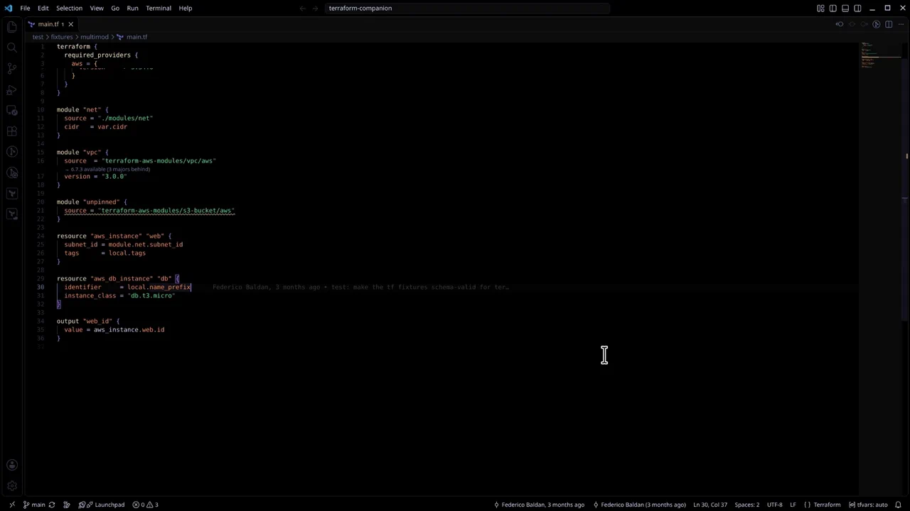

<p align="center">
  
</p>

<h2 align="center">Terraform Companion</h2>

<p align="center">
  Version CodeLens, resolved-value hover on <code>var</code>, <code>local</code> and <code>path</code>, <code>count</code>&nbsp;→&nbsp;<code>for_each</code> refactor,<br>
  plus unused-local, version-constraint and <code>depends_on</code> lints, and cleanup of stale Terraform caches.
</p>

<p align="center">
  <a href="https://marketplace.visualstudio.com/items?itemName=Federico-Baldan.tf-companion"></a>
  <a href="https://github.com/Federico-Baldan/terraform-companion/actions/workflows/ci.yml"></a>
  <a href="LICENSE"></a>
</p>

<p align="center">
  <a href="https://marketplace.visualstudio.com/items?itemName=Federico-Baldan.tf-companion"><strong>Install from the VS Code Marketplace →</strong></a>
</p>

<p align="center">
  <a href="#version-codelens"><kbd>Version CodeLens</kbd></a>
  <a href="#resolved-value-hover"><kbd>Resolved-value hover</kbd></a>
  <a href="#count--for_each"><kbd>count → for_each</kbd></a>
  <a href="#lints"><kbd>Lints</kbd></a>
  <a href="#cache-cleanup"><kbd>Cache cleanup</kbd></a>
</p>

<p align="center"><em>What does that <code>var.*</code> or <code>local.*</code> actually resolve to? Hover and find out.</em></p>

<p align="center">
  
</p>

<br>

You almost certainly already run the [HashiCorp Terraform](https://marketplace.visualstudio.com/items?itemName=HashiCorp.terraform) extension. Keep it. Formatting, completion, syntax checks and validation stay with terraform-ls, and Terraform Companion adds none of them. It reads your files and never runs Terraform.

## Install

```bash
code --install-extension Federico-Baldan.tf-companion
```

Needs VS Code 1.138 or newer. Activates when the workspace has a `.tf` file or a Terraform file is open.

## Version CodeLens

A lens above each `version` line shows the newest stable release and whether your constraint allows it. Click it to update the constraint or open the registry page.

```hcl
terraform {
  required_providers {
    aws = {
      source  = "hashicorp/aws"
      # → 6.0.1 blocked by your constraint (1 major)
      version = "~> 5.34"
    }
  }
}
```

The comment stands for the lens.

- The gap is measured from the release your constraint installs today, not from the floor you typed.
- A range that excludes the newest release reads "blocked". An exact pin reads like `→ 5.98.0 available (64 minors behind)`.
- It covers `required_providers` entries and `module` blocks with a registry source. Local paths, git URLs, other registry hosts and sources the registry does not know get no lens, and neither does a constraint already at the newest release.
- Answers are cached for 6 hours by default.

Setting: `tfCompanion.versionLens.enabled`.

## Resolved-value hover

Hover a `var.*` or `local.*` in a `.tf` file, or the name where it is defined, to see the string it resolves to.

```text
local.tg_name = satispay-payments-green-prod
28 chars · from prod.tfvars
```

The origin is a tfvars file, a variable default or a module call (`via module "app" (main.tf)`). "Copy value" copies the string.

- It follows the whole chain. `local.name = "app-${var.env}"` with `var.env = "dev"` in tfvars shows `app-dev`.
- In a called module, `var.*` comes from the call site, traced back to the root and its tfvars, or from the module's default. Calls that pass different values get one line each, with its own count (the first 8).
- The count is of the real string (a newline is one character). It helps catch names over a provider limit, such as the 32 characters of an AWS target group name. Lists, objects and values containing `⟨unknown⟩` get none.
- Expressions it cannot evaluate, such as conditionals and most functions, show `⟨unknown⟩`.
- In `resource`, `data`, `module` and `ephemeral` blocks, `count.index`, `each.key` and `each.value` show one line per instance, when `count` or `for_each` can be worked out from your files (up to 64 instances). Nested blocks are not covered.
- `path.root`, `path.module` and `path.cwd` resolve too. The root is the module no other module calls (calls from its own `examples/` do not count), or `terraformRoot`. `path.cwd` assumes that directory unless you set `terraformCwd`, and the hover says so.

Setting: `tfCompanion.resolvedHover.enabled`.

### Choosing the tfvars file

Each root module reads `terraform.tfvars` and `*.auto.tfvars` from its own folder, as Terraform does. `.tfvars.json` is not read.

To use another file, click the `tfvars: auto` status bar item or run `Terraform Companion: Pick the active tfvars file`. The pin works like `-var-file`: it belongs to the module of the open `.tf` file, overrides the auto-loaded files, and the file can live anywhere. The picker offers nearby tfvars files, recent picks and Automatic, which clears the pin. Browse… reaches files outside the workspace. A module that another module calls has no tfvars of its own, so the command says its values come from the call site.

## count → for_each

```hcl
resource "aws_instance" "web" {
  count = length(var.instance_names)
  tags  = { Name = var.instance_names[count.index] }
}
```

Drop the first name from that list and Terraform recreates every instance after it, because `count` keys instances by position. The warning appears on `count = length(var.*)` or `length(local.*)` in a `resource`, `data` or `module` block that indexes the list with `count.index`. The `Refactor: count → for_each` action rewrites it to `for_each = toset(...)` with `each.value`.

The action is hidden when the rewrite could change what Terraform builds:

- `count.index` is used elsewhere in the block.
- Something else in the module refers to the resource (`web[0]`, `web[*]`, a `depends_on` in another file).
- The elements are read as objects, or the variable declares a `type` other than `list(string)` or `set(string)`. A variable with no `type` still gets the action.
- The values are duplicates or not strings.

The warning stays. Resources already in state need `terraform state mv`, because their addresses change from the index to the value.

Setting: `tfCompanion.countForEach.enabled`. It hides the refactor too.

## Lints

| Lint | Flags | Setting |
|---|---|---|
| Unused local | A local no `.tf` file in the module references | `unusedLocals.enabled` |
| Unpinned module | A registry module without `version` | `versionHygiene.enabled` |
| Open-ended version | A module or provider constraint with no upper bound: only `>=`, `>` or `!=`, or a bare `~> 5` | `versionHygiene.enabled` |
| Variable docs | A variable without `description` or `type` (off by default) | `versionHygiene.variableDocs` |
| Redundant `depends_on` | An entry the block's own arguments already imply; the quick fix removes it | `dependsOn.enabled` |

Settings are under `tfCompanion.`.

## Files over 1 MiB

A file over 1 MiB (1,048,576 characters) is not parsed, and nothing in it is analysed. While one is in the workspace:

- the count → for_each refactor is withheld wherever the list takes its value from a variable's default, a tfvars file or a module call;
- the unused-local lint stays quiet for that module;
- the hover on a variable or a `path.*` value says it assumes no unread file sets or calls it.

The Terraform Companion output channel names the file.

## Cache cleanup

Shortly after startup, the extension looks for `.terraform` folders with no activity for 30 days (`cacheCleaner.staleDays`) and asks before deleting. Activity means a recent change to `.terraform` or its top-level entries, or to the `.tf`, `.tfvars`, `.hcl`, lock or state files beside it.

It deletes only the cache inside: `providers`, `modules` and the pre-0.14 `plugins` entries. `terraform init` rebuilds them. It keeps:

- `.terraform` itself and its metadata, so your selected workspace and `-backend-config` settings survive.
- Terraform state (`terraform.tfstate`, `terraform.tfstate.d/`) and `.terraform.lock.hcl`. They sit beside `.terraform` and are not touched.
- A pre-0.14 `plugins/<os>_<arch>/` without `lock.json`, which may hold a binary placed by hand.

Symlinks are not followed, and nothing outside the workspace folder is removed.

The prompt names the first three modules (then a count) and the approximate size. Review… opens a checklist of every cache with its path, size, last activity and the directories to delete. Everything starts checked, so uncheck what you want to keep. A row looks like this:

```
[x] infra/prod      12.0 MB · last activity 2026-05-04
    /repo/infra/prod/.terraform: deletes .terraform/providers, .terraform/modules
```

Ignoring or dismissing the prompt silences it for 7 days. The Terraform Companion output channel lists every cache before anything is removed. With `cacheCleaner.autoDelete` on, stale `.terraform` caches go without the prompt and are still listed there.

### Shared plugin cache

The cleaner also checks Terraform's shared plugin cache (`TF_PLUGIN_CACHE_DIR`, or `plugin_cache_dir` in your CLI config) with its own prompt. Every Terraform project on the machine uses it, so it always asks, even with `autoDelete` on, and you pick what to remove.

It offers provider versions installed more than `staleDays` days ago, unless a `.terraform.lock.hcl` in the workspace names the provider or an initialised project links it under `.terraform/providers`. The date is the install date, not the last use, so another project may still need the provider. If you delete one in use, that project needs `terraform init` again. The lock files are read again just before deleting.

It leaves the cache alone, and the output channel says why, when:

- no folder is open, or the lock files cannot all be read (a workspace folder with more than 200,000 entries counts);
- the cache path is relative;
- it points at a local provider mirror, such as `~/.terraform.d/plugins` or a `filesystem_mirror` path in your CLI config (a relative `filesystem_mirror` path counts too).

Set `cacheCleaner.sharedPluginCache` to `false` to skip it. It is a machine setting, so a workspace's `.vscode/settings.json` cannot change it. `cacheCleaner.enabled` turns off the whole cleaner.

## Offline

The version CodeLens is the only feature that uses the network (registry.terraform.io). Offline, or when the registry is down, it shows its last cached answer or no lens, never an error or a popup. Everything else runs on your machine.

## Settings

| Setting | Default | Notes |
|---|---|---|
| `tfCompanion.versionLens.enabled` | `true` | |
| `tfCompanion.versionLens.cacheTtlHours` | `6` | Hours a registry answer stays cached. Floored at 5 minutes |
| `tfCompanion.resolvedHover.enabled` | `true` | |
| `tfCompanion.terraformRoot` | unset | Absolute path of the root module, for `path.root` and `path.module`. Default: the module no other module calls. Relative paths and `${workspaceFolder}` are ignored |
| `tfCompanion.terraformCwd` | unset | Absolute path Terraform runs from, for `path.cwd`. Default: the root module directory |
| `tfCompanion.countForEach.enabled` | `true` | Also hides the refactor |
| `tfCompanion.unusedLocals.enabled` | `true` | |
| `tfCompanion.versionHygiene.enabled` | `true` | |
| `tfCompanion.versionHygiene.variableDocs` | `false` | Also flag variables without `description` or `type` |
| `tfCompanion.dependsOn.enabled` | `true` | |
| `tfCompanion.cacheCleaner.enabled` | `true` | Master switch: `.terraform` folders and the shared plugin cache |
| `tfCompanion.cacheCleaner.staleDays` | `30` | `.terraform`: days without activity. Shared plugin cache: days since install. Floored at 1 |
| `tfCompanion.cacheCleaner.autoDelete` | `false` | Delete stale `.terraform` caches without asking. The shared plugin cache always asks |
| `tfCompanion.cacheCleaner.sharedPluginCache` | `true` | Also offer to clean the shared plugin cache. Machine scope |

## Development

```bash
npm install
npm run build      # extension + WASM grammar into dist/
npm run watch      # rebuild on change
npm test           # vitest
npm run typecheck  # tsc --noEmit
npm run lint       # biome check
npm run package    # .vsix
```

## Licence

[MIT](LICENSE). Bugs and feature requests go in [Issues](https://github.com/Federico-Baldan/terraform-companion/issues).

<p align="center">
  <a href="https://federico.baldan.dev">
    <picture>
      <source media="(prefers-reduced-motion: reduce)" srcset="https://github.com/Federico-Baldan/terraform-companion/raw/HEAD/assets/signature/signature.png">
      
    </picture>
  </a>
</p>
