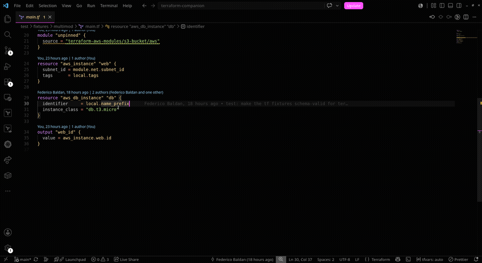

<p align="center">
  
</p>

<h1 align="center">Terraform Companion</h1>

<p align="center">
  <a href="https://federico.baldan.dev">
    <picture>
      <source media="(prefers-reduced-motion: reduce)" srcset="https://github.com/Federico-Baldan/terraform-companion/raw/HEAD/assets/signature/signature.png">
      
    </picture>
  </a>
</p>

<p align="center">
  Version CodeLens, resolved-value hover on <code>var</code> and <code>local</code>, <code>count</code>&nbsp;→&nbsp;<code>for_each</code> refactor,<br>
  plus unused-local and version-constraint lints.
</p>

<p align="center"><em>What does that <code>var.*</code> or <code>local.*</code> actually resolve to? Hover and find out.</em></p>

<p align="center">
  <a href="https://marketplace.visualstudio.com/items?itemName=Federico-Baldan.tf-companion"></a>
  <a href="https://github.com/Federico-Baldan/terraform-companion/actions/workflows/ci.yml"></a>
  <a href="LICENSE"></a>
</p>

<p align="center">
  <a href="https://marketplace.visualstudio.com/items?itemName=Federico-Baldan.tf-companion"><strong>Install from the VS Code Marketplace →</strong></a>
</p>

<p align="center">
  
</p>

<br>

You almost certainly already run the [HashiCorp Terraform](https://marketplace.visualstudio.com/items?itemName=HashiCorp.terraform) extension. Keep it. Formatting, completion, syntax and validation all go through terraform-ls, and nothing here reaches into any of that.

This fills the gaps terraform-ls leaves: it won't tell you a provider constraint is a major release behind, and it won't tell you what `var.environment` resolves to until you run a plan. Install both and they stay out of each other's way.

## Install

[**Terraform Companion on the VS Code Marketplace**](https://marketplace.visualstudio.com/items?itemName=Federico-Baldan.tf-companion), or from the command line:

```bash
code --install-extension Federico-Baldan.tf-companion
```

Requires VS Code 1.138 or newer. Activates on `.tf` / `.tfvars` files.

## Version CodeLens

```hcl
terraform {
  required_providers {
    # 6.0.1 blocked by your constraint (1 major)
    aws = {
      source  = "hashicorp/aws"
      version = "~> 5.34"
    }
  }
}
```

The lens sits over the `version` line. Click it to bump the constraint or open the registry page. It measures the gap from the release your constraint would actually install, not from the floor you typed. A `~> 5.34` that cannot cross into 6.x reads *blocked*, while an exact pin that could be raised reads *behind*. Modules work the same way. Answers are cached for six hours. If the registry does not recognise a source, the lens stays hidden instead of showing an error.

## Resolved-value hover

Point at a `var.*` or `local.*` to see the resolved string and its provenance: a tfvars file, a variable default, or an argument passed at a `module` call. The hover also includes a copy link.

The hover shows the value's character count. This helps catch names that exceed provider limits. For example, `28 chars` under `satispay-payments-green-prod` is easier to catch here than in a failed apply. An AWS target group allows 32 characters. The count uses the actual string, so a newline counts as one character, not the two characters in the rendered `\n`. Each instance gets its own count. Lists and objects have no count, and a value containing `⟨unknown⟩` has no count yet.

It follows the whole chain. `local.name = "app-${var.env}"` with `var.env = "dev"` in tfvars resolves to `app-dev`, not `dev`. Inside a called module, `var.*` comes from the call site and traces back to the root and its tfvars. If nobody passes a value, it falls back to the module's default. When two `module` blocks pass different values, the hover shows one line per instance.

A status bar item pins the active tfvars file when auto-loading is not enough. The pin behaves like `-var-file`: it belongs to the module where you set it, while the file can live anywhere, such as `environments/prod.tfvars` beside the module or in a parent folder. Each module keeps its own pin, and the status bar reports the pin for the file you're viewing.

The picker lists files the module could read, using paths relative to the module so similarly named files remain distinct. It identifies module folders by their `.tf` files, not their names. A module's entire subtree belongs to it, so `other/env/prod.tfvars` belongs to `other` just like `other/prod.tfvars`. Other nearby tfvars folders are also included, such as `environments/prod/`, `live/prod/vpc/`, and `config/`. Results are ordered by proximity: folders in the current module rank first regardless of name, self-named folders rank next, and other modules' subtrees rank lower. In a monorepo, shared `environments/` folders stay above sibling teams' folders. The picker only shows a shortlist. **Browse…** reaches the rest, including files outside the workspace.

Because a pin belongs to a module, the picker needs a `.tf` file open to identify that module. If the file belongs to a called module, it explains that Terraform reads values from the call site instead of that module's tfvars.

## count → for_each

```hcl
resource "aws_instance" "web" {
  count = length(var.instance_names)
  tags  = { Name = var.instance_names[count.index] }
}
```

Drop the first name from that list and Terraform destroys and recreates every instance after it, because `count` keys resources by position. The quick fix rewrites the block to `for_each = toset(...)` with `each.value` in place of the indexed reads, so each instance is keyed by its own value and reordering the list stops mattering.

It only offers the rewrite when the rewrite is safe. If `count.index` also drives something else in the block, if the resource is addressed by index somewhere else (`web[0]`, `web[*]`, a cross-file `depends_on`), if the elements get read as objects, or if the values would collapse under `toset()` because they're duplicates or not strings, the fix stays hidden. One caveat it can't fix for you: resources already in state need `terraform state mv`, since their addresses change from `[0]` to `["web"]`.

## Lints

- **Unused locals**, flagged on the definition line, scoped to the whole module so a local defined in one file and used in another doesn't get a false positive.
- **Version hygiene**: registry modules with no `version`, and `>=` / bare `~> 5` constraints that leave the upper end open. Optionally, variables missing a `description` or `type`.
- **Redundant `depends_on`**: an entry the block's own arguments already imply. The quick fix splices just that entry out and leaves your comments and formatting alone.

## `.terraform` cache cleanup

On startup it looks for `.terraform` folders whose module hasn't been touched in 30 days, and asks before deleting. These are caches `terraform init` rebuilds.

**It tells you what it is about to delete.** The prompt names the modules, such as `infra/prod, modules/vpc`, instead of showing only a count. **Review…** opens a checklist with each cache's full path, size, last-used date, and subdirectories:

```
[x] infra/prod      12.0 MB · last activity 2026-05-04
    /repo/infra/prod/.terraform: deletes .terraform/providers, .terraform/modules
[x] modules/vpc      5.0 MB · last activity 2026-02-13
    /repo/modules/vpc/.terraform: deletes .terraform/providers
```

Everything starts checked. Uncheck anything you want to keep; only the remaining caches are deleted. Before removal, the Terraform Companion output channel lists every cache, its path, and the directories to be deleted.

Only the cache is removed. `providers`, `plugins`, and `modules` are deleted, while `.terraform` and its metadata remain. Your selected workspace and `-backend-config` settings are preserved. Terraform state is not touched: it lives in `terraform.tfstate` and `terraform.tfstate.d/` beside `.terraform`, and `.terraform.lock.hcl` is a sibling. A pre-0.14 `plugins/<os>_<arch>/` without `lock.json` is left alone because it contains a manually placed binary that `terraform init` cannot restore. The scan does not follow symlinks and only removes directories named `.terraform`. Dismiss the prompt to suppress it for a week. Set `cacheCleaner.autoDelete` to skip the prompt.

## Offline

The CodeLens is the only feature that uses the network. Without a connection, or when the registry is down, it uses the last cached answer or stays hidden. There are no popups or red squiggles. Everything else runs on your machine.

## Settings

All keys are under `tfCompanion.`

| Setting | Default | Notes |
|---|---|---|
| `versionLens.enabled` | `true` | |
| `versionLens.cacheTtlHours` | `6` | floored at 5 minutes |
| `resolvedHover.enabled` | `true` | |
| `countForEach.enabled` | `true` | |
| `dependsOn.enabled` | `true` | |
| `unusedLocals.enabled` | `true` | |
| `versionHygiene.enabled` | `true` | |
| `versionHygiene.variableDocs` | `false` | also flag variables without `description` or `type` |
| `cacheCleaner.enabled` | `true` | on startup, offer to delete the cache of modules with no recent activity |
| `cacheCleaner.staleDays` | `30` | days of inactivity before a `.terraform` counts as stale; floored at 1 |
| `cacheCleaner.autoDelete` | `false` | delete without asking; the folders are still listed in the output channel |

## Development

```bash
npm install
npm run build      # extension + WASM grammar into dist/
npm run watch      # rebuild on change
npm test           # vitest
npm run typecheck  # tsc --noEmit
npm run lint       # biome check
npm run package    # .vsix
```

## Licence

MIT.

Bugs and feature requests go in [Issues](https://github.com/Federico-Baldan/terraform-companion/issues).
